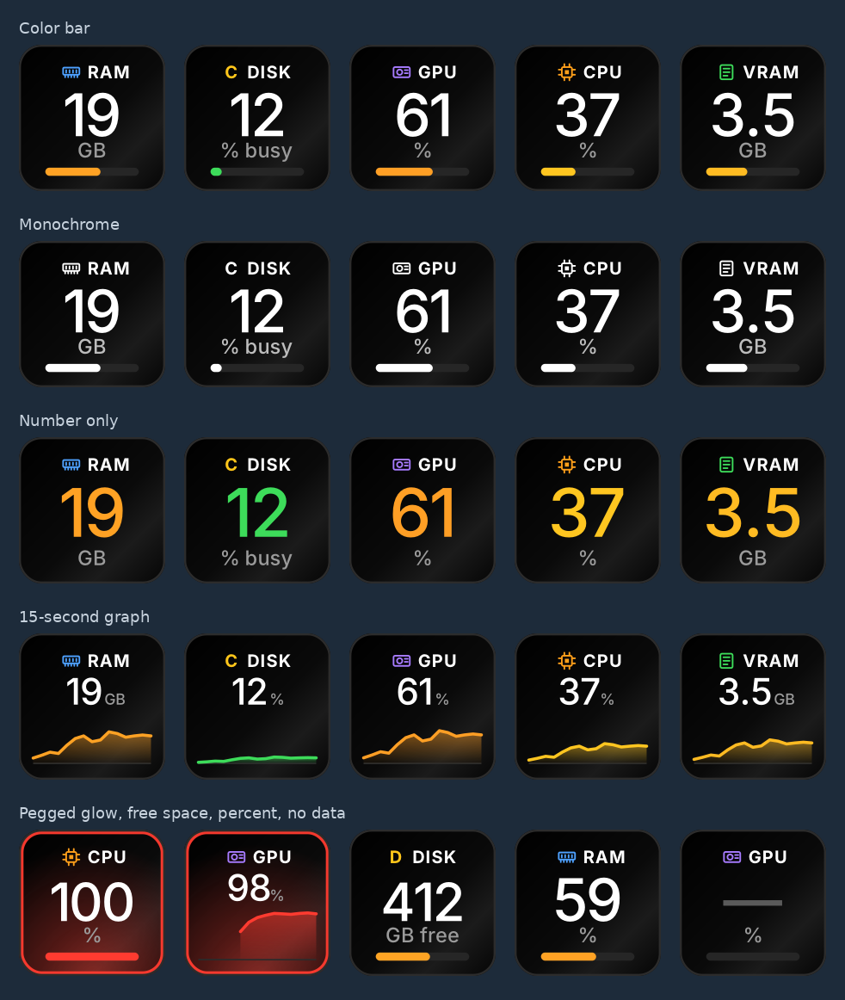
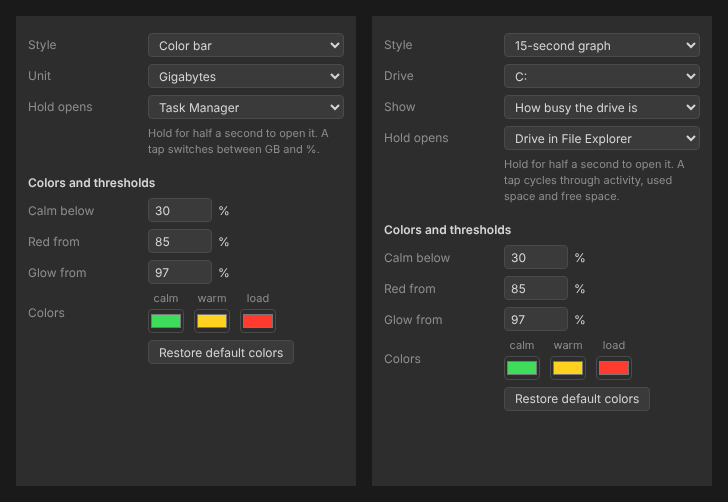

# Metrics

CPU, RAM, GPU, VRAM and disk, live on your Stream Dock keys. Built for the Ajazz AKP03E, works on any Stream Dock device.

## Install

1. Quit Stream Dock, including the tray icon.
2. Copy the `com.diy.metrics.sdPlugin` folder to:
   - Windows: `%APPDATA%\HotSpot\StreamDock\plugins\`
   - macOS: `~/Library/Application Support/HotSpot/StreamDock/plugins/`
3. Start Stream Dock and drag actions from the **Metrics** category onto your keys.

No drivers, no admin prompt, no account, no background service.

## What each key shows

| Key | Reading |
|---|---|
| CPU | Processor load, the same number Task Manager shows |
| RAM | Memory in use, in GB or as a percent of the total |
| GPU | Graphics load for Intel, AMD and NVIDIA (Apple silicon on a Mac) |
| VRAM | Video memory in use against your card's total (GPU MEM on a Mac) |
| Disk | How busy a drive is, how full it is, or how much space is free |

## Presses

- **Tap** RAM or VRAM to switch between GB and %. Tap Disk to cycle activity, used space and free space.
- **Hold** for half a second to open Task Manager, Resource Monitor, the drive in File Explorer or Storage settings. On a Mac: Activity Monitor, Finder, System Settings or System Information.

## Settings

- **Style:** color bar, monochrome, number only, or a graph of the last 15 seconds.
- **Thresholds:** green below *Calm*, warming through yellow and amber, red from *Red*, and a glow from *Glow*.
- **Colors:** all three are yours to change.

## How it works

All keys share one reading per second, so ten keys cost no more than one. On Windows a single hidden
PowerShell process reads the built-in performance counters through WMI, the same counters Task Manager uses.
It exits with Stream Dock and stops when no Metrics key is on the device.

## Troubleshooting

- Log: `com.diy.metrics.sdPlugin\plugin\log\plugin.log`
- GPU or VRAM shows "—": Windows 10 version 1709 or newer is required. If the VRAM total is wrong, enter it in the key settings.
- On macOS, disk activity needs root, so the Disk key shows space only.
