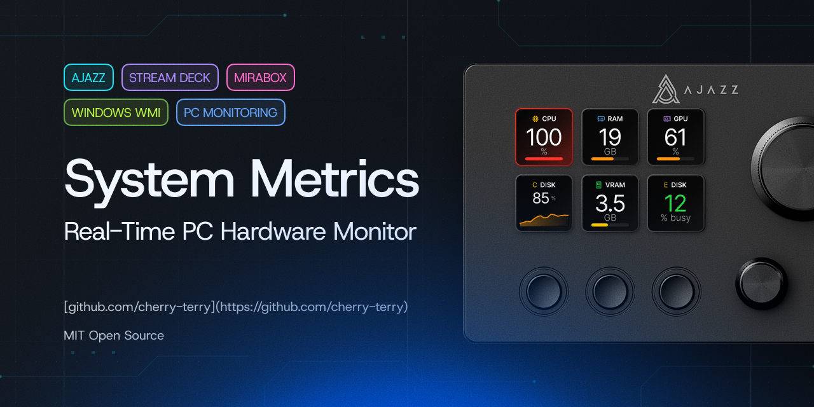

# 📈 Metrics

**CPU, RAM, GPU, VRAM and disk, live on your Stream Dock keys**

---

## ✨ Features

- 📊 **Five live readings**: CPU, RAM, GPU, VRAM and disk, updated every second.
- 🎨 **Four styles**: color bar, monochrome, number only, or a 15-second graph.
- 🔥 **Color thresholds**: green when calm, through yellow and amber to red, plus a glow when the load is pegged.
- 👆 **Tap to switch units**, hold to open Task Manager, File Explorer and more.
- 🪶 **Light**: all keys share one reading, so ten keys cost no more than one. No drivers, no admin prompt, no account, no background service.
- 🍎 **Windows and macOS**.

## 📦 Installation

> [!IMPORTANT]
> Quit Stream Dock completely, including the tray icon, before copying files.

1. Copy the `com.diy.metrics.sdPlugin` folder to:
   - **Windows:** `%APPDATA%\HotSpot\StreamDock\plugins\`
   - **macOS:** `~/Library/Application Support/HotSpot/StreamDock/plugins/`
2. Start Stream Dock.
3. Drag actions from the **Metrics** category onto your keys.

## 🎛️ Keys

| Key | Reading | Tap | Hold (0.5 s) opens |
|---|---|---|---|
| **CPU** | Processor load, the same number Task Manager shows | — | Task Manager or Resource Monitor |
| **RAM** | Memory in use | GB ↔ % | Task Manager or Resource Monitor |
| **GPU** | Graphics load for Intel, AMD and NVIDIA (Apple silicon on a Mac) | — | Task Manager or Resource Monitor |
| **VRAM** | Video memory in use against the card's total (GPU MEM on a Mac) | GB ↔ % | Task Manager or Resource Monitor |
| **Disk** | How busy a drive is, how full it is, or how much is free | Activity → used → free | The drive in File Explorer or Storage settings |

On a Mac, hold opens Activity Monitor, Finder, System Settings or System Information. You choose what each key opens in its settings.

## ⚙️ Settings

| Setting | Options |
|---|---|
| **Style** | Color bar, monochrome, number only, 15-second graph |
| **Unit / Show** | GB or % for RAM and VRAM. Activity, used or free space for Disk |
| **Drive** | Which drive the Disk key watches |
| **Hold opens** | What a half-second hold launches |
| **Calm below** | Green under this value (default 30 %) |
| **Red from** | Red from this value (default 85 %) |
| **Glow from** | Glowing red frame from this value (default 97 %) |
| **Colors** | Calm, warm and load colors are all yours to change |

## 🔧 How it works

All keys share one reading per second. On Windows, a single hidden PowerShell process reads the built-in performance counters through WMI, the same counters Task Manager uses. It exits with Stream Dock and stops when no Metrics key is on the device.

## 🛠️ Troubleshooting

| Problem | Fix |
|---|---|
| GPU or VRAM shows `—` | Windows 10 version 1709 or newer is required. |
| VRAM total is wrong | Enter it manually in the key settings. |
| Disk key on macOS shows space only | Disk activity needs root on macOS, so only space is available. |

Plugin log: `com.diy.metrics.sdPlugin\plugin\log\plugin.log`

## 📄 License

[MIT](LICENSE). Not affiliated with Ajazz.
